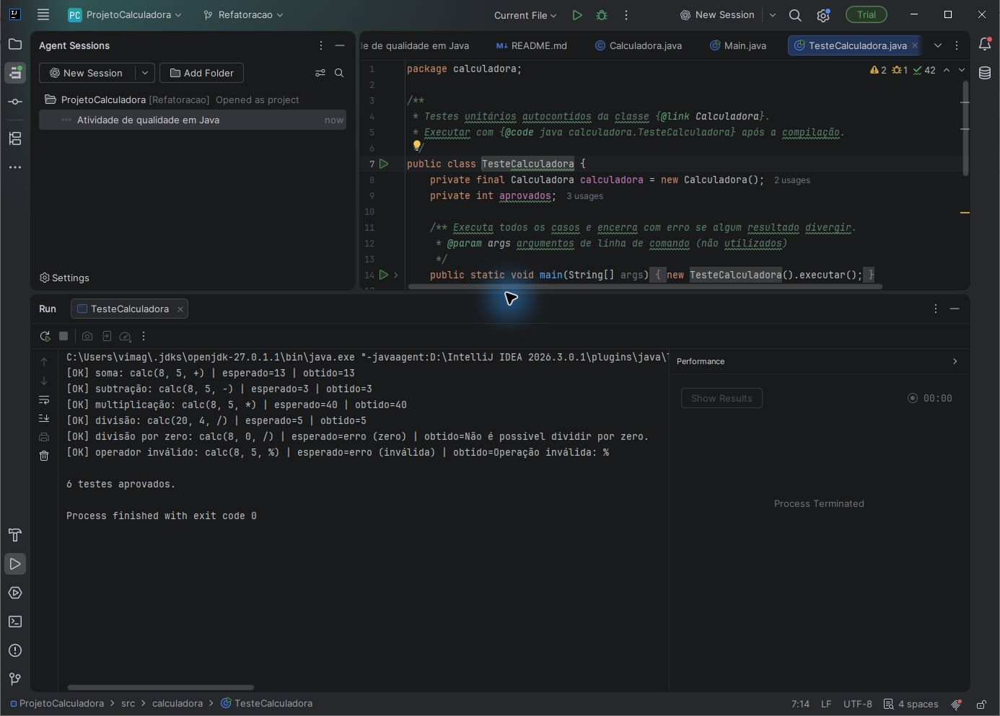
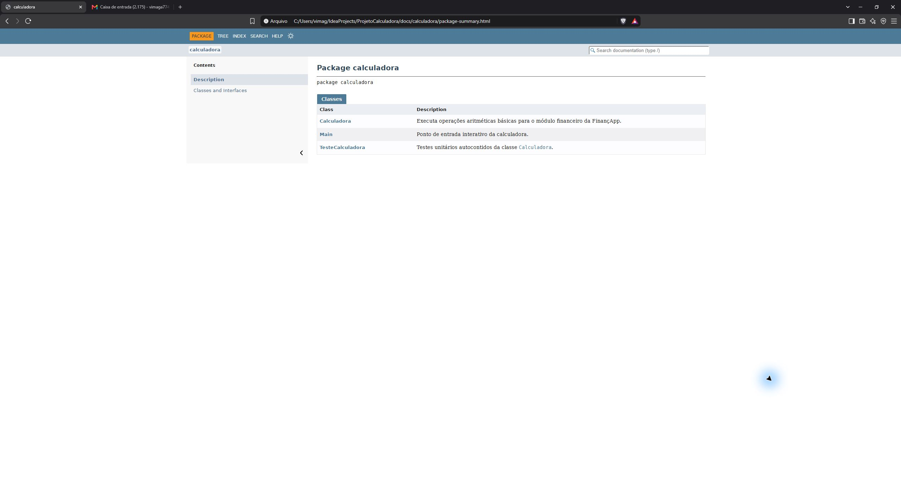

# Projeto Calculadora — FinançApp

Repositório acadêmico do projeto de calculadora.

## Descrição e objetivo

Calculadora em Java para apoiar cálculos básicos do aplicativo fictício FinançApp. A atividade demonstra implementação, validação por testes, tratamento de erros, refatoração, documentação técnica e versionamento.

## Tecnologias

- Java 17 ou superior
- Git
- JavaDoc (ferramenta incluída no JDK)

## Operações

O método `Calculadora.calc(int a, int b, String op)` aceita `+` (soma), `-` (subtração), `*` (multiplicação) e `/` (divisão inteira). Divisão por zero e operadores inválidos geram `IllegalArgumentException`; a aplicação de console captura o erro e informa o usuário sem encerrar de forma abrupta.

## Compilar e executar

No PowerShell, a partir da raiz do projeto:

```powershell
New-Item -ItemType Directory -Force out | Out-Null
javac -d out src/calculadora/*.java
java -cp out calculadora.Main
```

## Testes

```powershell
java -cp out calculadora.TesteCalculadora
```

Os testes exibem entradas, resultado esperado e resultado obtido. Os casos cobrem soma, subtração, multiplicação, divisão, divisão por zero e operador inválido.

### Evidências dos testes

Saída validada localmente:

```text
[OK] soma: calc(8, 5, +) | esperado=13 | obtido=13
[OK] subtração: calc(8, 5, -) | esperado=3 | obtido=3
[OK] multiplicação: calc(8, 5, *) | esperado=40 | obtido=40
[OK] divisão: calc(20, 4, /) | esperado=5 | obtido=5
[OK] divisão por zero: calc(8, 0, /) | esperado=erro (zero) | obtido=Não é possível dividir por zero.
[OK] operador inválido: calc(8, 5, %) | esperado=erro (inválida) | obtido=Operação inválida: %
6 testes aprovados.
```

Captura da execução na IDE:



## Documentação JavaDoc

Com um JDK instalado e `javadoc` disponível no `PATH`, gere a documentação com:

```powershell
javadoc -encoding UTF-8 -d docs src/calculadora/*.java
```

O arquivo de entrada é `docs/index.html` quando gerado pela configuração compatível com a versão do JDK. Abra-o no navegador para conferir as classes, métodos, parâmetros, retornos e exceções documentados.

### Evidências da documentação

A documentação completa está em [`docs/index.html`](docs/index.html). A captura abaixo mostra a página JavaDoc com o pacote e as classes documentadas.



## Refatoração e versionamento

O método de divisão foi extraído para `dividir`, os nomes descrevem o papel dos operandos e a seleção de operação usa uma expressão `switch`. Para demonstrar o histórico exigido, mantenha a versão inicial na branch principal e aplique esta versão na branch `Refatoracao`, execute novamente os testes e registre commits organizados.

## Repositório

Link do GitHub: [VitorHMG/ProjetoCalculadora---UI-UX](https://github.com/VitorHMG/ProjetoCalculadora---UI-UX).

## Estrutura

```text
src/calculadora/Calculadora.java
src/calculadora/Main.java
src/calculadora/TesteCalculadora.java
docs/                         (gerado com JavaDoc)
evidencias/testes.jpg         (execução dos testes)
evidencias/javadoc.jpg        (JavaDoc no navegador)
```
